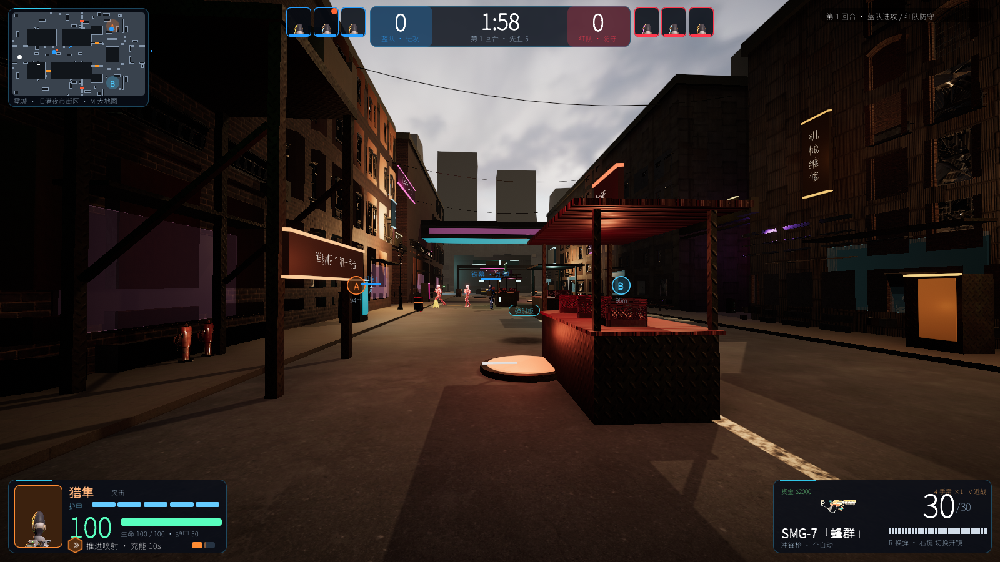

# 《霓城封锁 NEON LOCKDOWN》美食大作战 · V20

## V20 更新：角色 / 枪械 / 3C（战斗策划向）
完整设计说明见 [Docs/战斗设计文档_角色_枪械_3C.md](Docs/战斗设计文档_角色_枪械_3C.md)。
- **枪械**：
  - 五个部位（头 / 胸 / 腹 / 臂 / 腿）各有倍率；护甲和头盔分等级，子弹有穿透等级，"穿透 − 等级"决定伤害进生命还是磨护甲。
  - 固定弹道加少量随机，可以学会压枪。
  - 每把枪有开镜、冲刺转开火、拔枪、战术 / 空仓换弹的独立时间。
  - 子弹会下坠；薄墙可以打穿，打穿后伤害打折。
- **3C**：
  - 新增趴下（Z）。
  - 体力系统：冲刺、跳跃、翻越都消耗体力。
  - 负重：武器重量 + 护甲等级，超重会变慢、开镜变慢。
  - 跳跃输入缓冲和离地宽限。
  - 开镜和蹲下都可以选"按住"或"切换"。
  - 开镜灵敏度按视野换算；晃动和震动幅度可调。
- **角色**：
  - 统一判定：胶囊体 + 头部判定球，与外观无关，按 F2 可以显示。
  - 干员护甲 / 头盔等级。
  - 死亡回顾：被谁、用什么、多远，最后几发打在哪。
- **工具**：
  - 数值表：`StreamingAssets/Data/weapons.csv`、`heroes.csv`、`tuning_3c.csv`，打包后可以直接改。
  - F1 调参面板：实时生效，可以导出回表格。
  - 靶场：主菜单切换模式进入。有 5 个靶子，护甲等级可切换；面板显示实测与理论 TTK 对比，还有弹道图。
  - 试玩数据新增部位命中分布、护甲伤害、穿墙命中等列。


## V19 更新：能交互的东西一眼看得出来 + 地图萌化
- **交互标记**：所有能交互的东西都有统一的醒目标记：
  - 地上一圈呼吸闪烁的光环
  - 头顶上下跳动的气泡，写着能做什么，比如"G 吃掉 · +25 生命"
  - 周围飘着亮晶晶的小粒子

  带标记的有：零食、火锅回血炉、奶茶机、烤箱、冰柜、食材、外卖箱、掉落的枪、曼妥思可乐、大锅、医疗站、电闸、卷帘门、门禁。路边的装饰美食没有标记，一看就能分清。
- **美食道具被打会像果冻一样抖一下**，包括路边美食、美食方块和美食塔。
- **地图萌化**：
  - 所有楼顶一圈奶油滴边（白 / 粉 / 巧克力），带彩色糖粒。
  - 墙和地面换成糖果图案：草莓奶油圆点墙、威化格墙、撒满糖粒的路面、饼干砖人行道、香草奶油屋顶、糖果条纹。
  - 人行道两边红白糖果条纹路沿；外圈人行道 16 棵棉花糖树；路边一堆堆彩色糖粒；天上 12 朵慢慢飘的棉花糖云。
  - 大美食都加了可爱的表情脸（眼睛、高光、腮红），包括奶茶、火锅、蛋糕、甜甜圈、汉堡、冰淇淋、美食方块、松饼塔等。
- **文字修复**：图鉴的标题不再被切掉一半；帮助页换成美食版，每行都很短，不会折行重叠，右边列出了地图上所有能交互的美食。


## V18 更新：完整玩法优化（A–E 五个阶段）

### A · 基础修复
- **敌我颜色修好**：Blender 导出时材质名被加了 `.001`，导致所有豆子都是同一种蓝色。现在蓝队蓝、红队红；敌人加**红色粗描边**，队友加**蓝色描边**，脚下还有一圈**队伍颜色光环**。
- **美食准镜**：开镜时枪模收起，换成每把枪自己的准镜（瓶口圆圈、吸管双环、爆米花散布圈、寿司盘、蒸笼格、裱花嘴星形）；冰糖葫芦和奶油裱花是整片柠檬切片的全屏狙击镜。
- **阵亡"噗"地消失**：倒地 0.7 秒后变成一团彩带，身体消失，原地留下一个打翻的盘子；复活时恢复。
- **交互键提示统一成 G**（原来提示圈里写的是 E，而 E 是探头）。
- **火锅回血炉**（3 处）：站在锅边按住 G 涮一涮，每秒 +10 生命，一次最多回 60；热气会让敌人透墙看到你。

### B · 食材变身 + 食物反应
地图上 18 个刷新点会刷出 13 种食材，最多拿两样，**凑成一道菜就变身**（10–15 秒，头顶会顶着对应的大菜）：
| 组合 | 变身 | 效果 |
| --- | --- | --- |
| 面粉 + 鸡蛋 | 巨型蛋糕 | 体型变大、+100 护甲、变慢，冲刺撞飞敌人 |
| 牛奶/茶叶/珍珠 任两样 | 奶茶杯 | 加速 30%，开火不耗弹药 |
| 辣椒 + 火锅底料 | 麻辣火锅 | 子弹灼烧，身边热浪烫伤敌人 |
| 面包 + 芝士 | 汉堡 | 正面受到的伤害减少 60% |
| 冰块 + 糖 | 冰淇淋 | 子弹减速，连中 3 次直接冻住 |
| 米饭 + 海苔 | 饭团 | 冲刺时滚成饭团，撞人造成伤害并弹飞 |
| 乱配 | 黑暗料理 | 冒绿烟、自己慢慢掉血，但子弹让敌人看不清 |

阵亡会掉落身上的食材。食物反应：
- 汽水手雷炸到曼妥思可乐 → 可乐喷泉把人冲上天
- 冰淇淋形态打火锅 → 热气散开 8 秒
- 番茄酱打黄油地面 → 更滑
- 辣椒形态打巧克力酱 → 热巧克力会烫
- 饺子打进火锅 → 溅出来烫伤旁边的人
- 奶油打蛋糕墙 → 把打掉的块补回来

### C · 厨房设施 + 英雄被动和大招
- **奶茶机**（两边出生区）补满弹药和手雷；**烤箱**烤 5 秒得到"金黄酥脆版"（伤害 +15%）；**冰柜**给 +50 冰护甲。
- **外卖无人机**：大乱斗 / 抢食 / 变大模式每 45 秒、爆破模式每回合一次，空投一个外卖箱，抢到的人直接变身并补满弹药。
- **传菜转盘**：中路的大转盘，站上去会被带着转。
- **大招（X）**：打伤害充能。
  | 英雄 | 被动 | 大招 |
  | --- | --- | --- |
  | 猎隼 | 吃零食回血翻倍 | 双层汉堡冲撞 |
  | 铆钉 | 掩体更耐打（+30%） | 饭团城墙（3 面可翻越的饭团墙） |
  | 铁幕 | 爆炸伤害减半 | 果冻罩（罩内队友回血） |
  | 夜鸦 | 打中的敌人被标记 3 秒 | 回转寿司雷达（全图显示敌人 5 秒） |
  | 焚芯 | 手雷范围 +20% | 生日蜡烛轰炸 |
  | 幻频 | 15% 概率甩糖挡掉一发 | 糖霜风暴（大范围干扰） |

### D · 新模式（主菜单"切换模式"循环切换）
- **抢食大作战**：3v3，有复活。把食材送回自己队的大锅，每样 +1 分，凑成一道菜再 +1；可以去对面锅里偷（对方 -1 分）。先到 20 分获胜。
- **吃货变大**：6 人各自为战。吃零食 +1 级，击杀 +2 级，阵亡减半；越大越肉、越慢、越显眼，时间到时最大的人获胜（或先到 12 级）。

### E · 打磨
- **表情**：1 挥手、2 点头、3 摇头，别人头上会冒气泡；赢下回合 / 比赛时全队跳庆祝动作。
- **今日菜单**：结算时给出称号，包括今日主厨、番茄酱狂魔、火锅守护者、百变吃货、黑暗料理大师、吃货本货、偷菜大盗。
- **音乐**：程序合成的轻快美食街背景音乐（`Tools/synth_food_music.py`），火锅回血炉有咕嘟声。
- **帽子与菜谱图鉴**（主菜单）：3 顶特别帽子可解锁，解锁后只给你自己戴：章鱼烧（累计 30 杀）、小笼包（累计变身 10 次）、披萨（赢一场）。做出过的菜会在图鉴里点亮。


## V17 更新：美食 FPS 四个阶段全部完成

### 第一阶段 · 武器重做 + 打击感
- **整把枪就是一种食物，打出去的也是这种食物**（`Tools/blender_food_guns.py`，Blender 建模）：
  | 武器 | 打出 | 特色 |
  | --- | --- | --- |
  | P-9 番茄酱瓶 | 番茄酱 | 免费手枪 |
  | SMG-7 珍珠奶茶 | 珍珠 | 杯子就是弹匣，奶茶液面跟着弹药下降 |
  | AR-9 爆米花机 | 爆米花 | 顶上是一箱爆米花 |
  | LMG-2 回转寿司 | 寿司 | 加特林式转盘，开火时会转 |
  | DMR-3 冰糖葫芦 | 山楂 | 一串 5 颗，打一发少一颗；柠檬片瞄准镜 |
  | FS-12 饺子蒸笼 | 一把饺子 | 蒸笼 + 饺子形泵把 |
  | BR-5 奶油裱花 | 奶油 | 打中的敌人减速 0.8 秒 |
- 近战换成**平底锅**（锅里有个煎蛋），挥锅的瞬间能挡住正面打来的子弹；手雷换成**摇晃过的汽水罐**，炸开溅一地汽水。
- 第一人称换成**白色卡通手套**。
- **打击感**：子弹是飞出去的食物模型，拖着酱汁色尾巴；打中墙和地面会"啪"地留下酱汁；打中人溅出对应颜色的酱汁；击杀时角色"噗"地变成一团彩带；开火时枪身像果冻一样压扁再回弹。
- **音效全部原创合成**（`Tools/synth_food_sfx.py`）：噗、啵、咕叽、平底锅"当"、汽水嘶嘶、派对拉炮等 13 种，每种 3 个变体。

### 第二阶段 · 地图玩法
- **能吃的补给**：地图上 7 处零食（蛋糕、奶茶、甜甜圈……），按住 G 吃掉 +25 生命，25 秒刷新。
- **巧克力酱地面**会减速，**黄油地面**会打滑。
- **火锅**（南工厂通道）：热气挡住视线（AI 也看不穿，子弹能穿过），站进锅里会被烫，可以翻上锅沿。
- **蛋糕墙**：两面可破坏墙换成一层层的蛋糕，一块块打掉。
- **果冻弹床**：弹射板换成彩虹果冻，弹人时会抖。
- **AI 会爬了**：美食方块加了导航连接，AI 会翻上去，守方有时会守在 A 点蛋糕方块顶上。

### 第三阶段 · 模式和节奏
- **蛋糕爆破**：炸弹换成插着蜡烛的生日蛋糕，安装 = 放蛋糕点蜡烛，拆除 = 吹灭蜡烛，爆炸时奶油和彩带炸满一地。界面里的文字跟着换。
- 赢钱改叫**小费**，买枪界面改成**美食街菜单**，每把枪一张菜品卡。
- **新模式 · 美食大乱斗**：主菜单里切换。6 人各自为战，阵亡 3 秒后复活，复活时随机拿一把美食枪，阵亡会掉落手里的枪给别人捡，先到 15 杀获胜（5 分钟时间到则击杀最多者获胜）。

### 第四阶段 · 角色
- **糖豆人式豆子角色**（`Tools/blender_bean_character.py`）：在原来的骨骼上重做身体，17 个动作全部保留。圆滚滚的身体、白色脸罩、大眼睛和腮红、白手套、小短腿；身体是队伍颜色，头顶是英雄颜色。
- **每个英雄一顶美食帽子**：猎隼汉堡、铆钉饭团、铁幕布丁、夜鸦寿司、焚芯纸杯蛋糕（带蜡烛）、幻频甜甜圈。


## V16 更新：糖豆人风格 + 能爬的美食掩体
- **糖豆人式建模**：新增 `Tools/fallguys_style.py`，枪和美食导出前统一处理：
  - 倒角加大、方块全部细分，形状圆鼓鼓的；
  - 颜色饱和度 +22%；
  - 材质改成带一点光泽的糖果塑料感（粗糙度 0.3，加清漆层）。
- **场景配色**：地面换成淡紫，人行道粉色，楼墙用珊瑚红、天蓝、奶油黄、薄荷绿，表面带轻微光泽。
- **能爬的美食掩体**：
  - 集装箱全部换成 2 m 高的美食方块（巧克力、草莓海绵蛋糕、威化、彩虹果冻），走到跟前按空格就能翻上去。
  - 叠了两层的，上层短 1.5 m，留出台阶，可以一层层爬到 4 m 高。原来弹射板弹上去的位置不变。
  - 北长街新增**松饼塔**、南工厂通道新增**三层生日蛋糕**：每层 1 m 左右，可以一层层翻到顶，顶上视野很好。
- 新增测试 M11：松饼塔连续翻 3 次到顶；直接翻上巧克力方块。


## V15 更新：Q 萌卡通 + 甜品枪 + 美食城
- **画风**：人物换成 Quaternius Toon Shooter 卡通士兵（蓝/红队配色、描边），场景改成明亮纯色 + 晴天天空，远景用 KayKit 卡通楼。
- **甜品枪（Blender 自建模）**：`Tools/blender_dessert_guns.py` 生成 7 把枪，放在 `Assets/Resources/Toon/Dessert`：
  P-9 棒棒糖手枪、SMG-7 甜甜圈冲锋枪、AR-9 冰淇淋步枪、LMG-2 生日蛋糕机枪、DMR-3 拐杖糖狙击枪、FS-12 纸杯蛋糕霰弹枪、BR-5 巧克力棒步枪。
  游戏里按枪模里的 Muzzle 空物体定位枪口；找不到 GLB 时用代码拼的简化版。第一人称会隐藏枪托，免得挡住视线。子弹是彩色糖粒。
- **美食地图（Blender 自建模）**：`Tools/blender_food_props.py` 生成 15 个美食道具，放在 `Assets/Resources/Toon/Food`：
  奶茶、鸳鸯火锅、三层生日蛋糕、蛋糕切块、甜甜圈、汉堡、寿司、饺子、马卡龙、冰淇淋、冰棍、棒棒糖路灯、串串、拉面、拐杖糖围栏。
  - 路障 → 蛋糕切块掩体；垃圾桶 → 大碗拉面；发电机 → 汉堡；油桶 → 串串；路灯 → 棒棒糖路灯；轮胎 → 甜甜圈。
  - 主街 5 个摊位改成 奶茶 / 火锅 / 甜品屋 / 拉面 / 烧烤串串，台面上摆着对应的食物。
  - 楼顶和远景有 20 多个巨型美食地标（十几米高的奶茶、冒热气的火锅、蛋糕、冰淇淋……），只做装饰，不挡路。
  - 掩体的位置和大小没变，所以原来的走位和战术都还能用。


## V13 更新
- **新按键**：Q / E 左右探头 · F 技能 · G（按住）交互/安装/拆除 · 4 手雷 · V 近战 · B 购买武器。
- **探头**：头和枪向侧面探出 0.38 m 并倾斜 14°，身体留在掩体后；头部判定跟着移动，贴墙时不能把头探进墙里；第三人称会弯腰侧身；AI 在掩体后也会探头。
- **敌人醒目**：红队改成猩红装甲、蓝队改成钴蓝装甲；视野内的敌人有明显的红色描边（160 m 内），设置里可调强弱。
- **侦测箭显形**：被扫到的敌人透墙显示为接近实心的红色剪影，头顶有闪烁的"已暴露 · 名字 · 距离"标记；被扫到的一方屏幕边缘闪红并提示"你的位置已被侦测"。
- **小地图重做**：道路浅色、楼房深色带描边；小地图只保留包点、队友、被发现的敌人、炸弹和门；按 M 的大地图显示全部交互物，区域名改成带底色的大字。
- **开局选枪**：
  - 任何英雄都能买 7 把武器中的任意一把；免费手枪 P-9「哨兵」保底；英雄的招牌武器 7 折。
  - 经济：开局 $2000，赢一回合 +$2500，输 +$1700（连败每回合额外 +$300，最多 3 次）；击杀 +$300，安装炸弹 +$300，上限 $9000。
  - 活到回合结束可以保留武器，阵亡则下回合拿手枪。AI 也会按经济买枪。
- **可破坏墙**：A 点南墙和 B 厂房西墙改成薄墙（贴有"可击穿 / 炸开"标识），由 0.5 m 方块拼成。子弹 3 发打穿一块；手雷或焚芯爆破能炸出约 2 米的洞。洞够大时 AI 也会从洞里走。每回合恢复。
- **音效替换（Sonniss GDC 免费音效包）**：
  - 7 把枪全部换成真实录音：
    - SMG-7：MP7 / MP5
    - AR-9：L85
    - LMG-2：BAR / AK47
    - DMR-3：SVD
    - FS-12：Saiga-12 / 12 号霰弹枪
    - BR-5：M4 点射
    - P-9：MP5 提速
  - 远处开枪会叠一层远场回声。
  - 换弹改用真实的 G36C、SVD、Saiga、霰弹枪泵动、TMP 拉栓录音。
  - 新增敌方子弹擦耳而过的"嗖"声、弹壳落地声；命中肉体、混凝土、金属各有专门音效；爆炸换成真实录音并叠加远处回声。

---


## V12 更新：接入 Unity FPSSample 的人物、手臂、武器和动画
素材来自 Unity 官方开源项目 [FPSSample](https://github.com/Unity-Technologies/FPSSample)，授权为 Unity Companion License（允许在基于 Unity 的项目中使用）。原始素材备份在 `E:\Claude工作区\素材\FPSSample`。
- **人物**：6 个英雄都换成 Terraformer 装甲兵（高精度模型，带头盔、背包、发光装甲灯）。
  - 蓝队装甲偏冷色，红队偏暖色；装甲灯是队伍色，头盔面罩是英雄色。
  - 动作换成 FPSSample 的动画：8 个方向的奔跑、冲刺、蹲伏、射击、换弹、近战、按受击方向的 4 种受击反应和 4 种倒地。
- **第一人称**：换成 Terraformer 的手臂加武器，有真正的持枪、奔跑、冲刺、开镜、换弹、近战、跳跃、落地和受击动画。手臂和枪的动画同步播放（换弹时手真的在拆弹匣）。
- **武器**：狙击类（DMR-3）用 Terraformer 狙击步枪，其余 5 把用 Terraformer 步枪。头像和武器图标也重新渲染。
- **材质**：编辑器脚本 `Assets/Editor/FPSImport.cs` 读取 FPSSample 原来的 HDRP 材质文件，自动转成 Built-in 渲染管线的 Standard 材质（颜色、法线、金属度、粗糙度、环境光遮蔽、自发光贴图都保留），共 32 个。

---


## V11 更新（借鉴开源 FPS：AssaultCube、Xonotic）
参考 [bobeff/open-source-games](https://github.com/bobeff/open-source-games) 列表里的同类游戏，只借鉴玩法设计，代码全部自己实现，没有拷贝它们的代码或素材。
- **连射后坐递增**（AssaultCube）：前两三发几乎不跳，持续扫射后后坐按连发数的平方增长，最多到 2.2 倍。自动武器前两发的扩散增长也减半。点射和压枪变得更有价值。
- **开镜稳定时间**（AssaultCube 狙击枪）：倍镜武器开镜后 0.35 秒内准星从腰射精度逐渐收紧；稳定后后坐力只有三分之一。
- **手雷（G）**（AssaultCube）：每回合 1 颗，按住显示抛物线，松开投出，会弹跳，引信 2.5 秒，指示灯越闪越快。半径 6.5 米、最高 95 伤害，需要视线；不伤队友，伤自己减半；能炸毁可破坏掩体。AI 会把手雷扔向躲在掩体后、距离 8–24 米的敌人。
- **枪托近战（V）**：1.9 米内正面 55 伤害，从背后 120 伤害（背刺）。AI 贴身时也会用。
- **友军准星提示**（AssaultCube）：准星对着队友时变绿，并显示"友军 · 名字"。
- **命中音调随伤害变化**（Xonotic）：打得越重，命中音越低沉。

### 素材评估
这些开源游戏的枪械和地图素材这次都没有用：
- AssaultCube 的素材默认保留版权、禁止商用。
- Red Eclipse（CC-BY-SA）和 Liblast（MIT）的授权允许使用，但都是科幻风格，和本作的写实军事风不搭；Red Eclipse 还要从它自家引擎的格式转换，Liblast 只有一把枪和一张白模地图。
- Xonotic 是 GPL 授权，不建议用进本作。

---


## V10 更新（第 2 阶段可做部分 + 第 5 阶段：AI、平衡）
- **枪械写实材质**：6 把枪的卡通配色全部换成写实 PBR，按原色分类为黑色聚合物、磷化枪钢、深橄榄护木和军绿配件。模型形状没变，但塑料玩具感明显减弱。
- **人物军用配色**：蓝队换成灰蓝作战服，红队换成狼棕作战服，英雄色只保留一点；身体的队伍发光减弱，胸前和背后的队伍灯条保留，用来分清敌我。
- **AI 用上新地图**：
  - 守方神射手有六成概率踩弹射板上市场楼顶架枪；攻方神射手有四成五概率先上水塔压制 30 秒，再跳下来参与进攻。
  - 新增"A 长街墙洞""B 工厂墙洞"两条进攻路线：AI 会先打碎堵洞的木箱再钻过去。
  - 弹射板只在 AI 要上狙击高台时才会弹它，不会再把 AI 意外弹上集装箱卡住。
- **修复 AI 卡住**：
  - 铁门前 AI 停下的位置比"按 E"判定远了约 5 厘米，所以从不开门，已修正。
  - 半自动武器之前一直按着扳机，只打得出一枪，所以打不碎墙洞木箱，已改为反复扣扳机。
  - 检查站岗亭原来挡在墙洞正前方，已挪到另一侧。
- **平衡**：回合时长从 105 秒延长到 120 秒，抵消长街加铁门后进攻变慢的影响。
- **画面**：主街工厂立面的白色窗框压暗、去掉光泽。

---


## V9 更新（完整修改方案 · 第 3、4 阶段：手感、声音、UI）
### 手感
- **滑铲**：冲刺中按下蹲（Ctrl / C）滑行 0.8 秒，初速约为冲刺的 1.3 倍，可用方向键微调，按跳跃可取消（滑铲跳）。滑行时镜头压低、视野变宽、画面略微倾斜，冷却 1.1 秒。
- **翻越**：面前有 0.55–2 米高的障碍时按空格会攀上去（约 0.4 秒），沙袋、路障、箱子、矮墙都能翻。
- **后坐回正**：连射后准星会自动回落约六成；如果你自己往下压过枪，就不会再额外回落。
- **镜头和武器**：左右移动时镜头轻微倾斜、武器向反方向拖后；落地时镜头和武器会下沉，落差越大沉得越多；冲刺时视野变宽。
- **脚步声区分地面**：踩在钢板、铁皮上是金属声，其他地面是混凝土声。

### 声音
- **距离和遮挡**：远处的声音变闷，隔着墙的声音更闷、更小；近处保持清脆。
- **混响**：B 车间是空旷厂房的回声，两条小巷是窄巷回声，其余街区是城市混响。
- **环境声**：持续的风声；封锁区外每隔 9–22 秒有一阵远处交火；每隔 45–80 秒有远处的防空警报。风声和警报声是程序合成的，没用外部素材。

### UI 与流程
- **主菜单**：背景是实时地图的缓慢环绕航拍，有开始作战、操作说明、设置、退出游戏。
- **暂停菜单**（Esc）：游戏会真正暂停，有继续游戏、设置、操作说明、返回主菜单、退出游戏。
- **设置**：鼠标灵敏度、开镜灵敏度倍率、视野（65–100°）、主音量、画质（低/中/高）、是否显示伤害数字，会自动保存。画质"低"会关闭环境光遮蔽和泛光，并缩短阴影距离。
- **结算界面**：新增"返回主菜单"。

---


## V8 更新（完整修改方案 · 第 1 阶段：画面底子）
- **烘焙全局光照**：
  - 地图在编辑器里按运行时同样的规则生成，烘焙光照贴图和光照探针，游戏开局再把烘焙结果贴回运行时生成的物体（按渲染器顺序和名称校验）。
  - 墙角、室内、遮挡处有了真实的反弹光和接触阴影，B 车间室内的明暗过渡更自然。
  - 楼体、墙面、地面等基础几何体烘焙光照贴图；导入的道具模型用光照探针照明。
  - 菜单 `Neon Siege/Bake Map Lighting` 可单独重新烘焙；`BuildDemo.SetupAndBuild` 已包含烘焙步骤。
- **去掉廉价霓虹**：取消檐口灯带、地面霓虹线、全息广告牌、发光窗户卡片和摊位霓虹边条。霓虹拱门改成"军事管制区"钢架门楼，大部分窗户改为暗玻璃，只有少数亮着暖光。
- **远景楼**：空白的米色方块换成 ambientCG 照片立面（4 种），去掉巨型霓虹字。
- **贴花**：路面黄、白虚线，人行横道，指向包点的路面箭头，沥青补丁，油渍，井盖；墙面的雨水流痕和墙根污渍（雨痕和污渍贴图是程序生成的）。
- **军管道具**：检查站有探照灯、弹药箱、绿色油桶、空压机、篷布车；攻方集结区有补给堆；守方据点有吨桶和篷布车；A 货场有吨桶和推车；B 车间有工具车、焊接车和吊灯；街上加了消防栓、壁灯和燃烧的油桶。
- **修复**：
  - 截图工具改为抓取真实屏幕画面。原来手动渲染到贴图的方式会随机丢失间接光，导致截图忽明忽暗，以前版本里那些偏暗的截图也是它造成的，游戏本身不受影响。
  - 环境光遮蔽改为叠加模式，强度降低。

---


## V7 更新（地图大改：交互要合理、玩法要多）

### 每条进攻路线的"代价"
| 路线 | 怎么过 | 代价 |
| --- | --- | --- |
| 北长街 → A | **检查站铁门**是唯一通路，长按 E 2.4 秒开启 | 开门时有巨响，全图都能听到；门后守方 A 长街狙击位正对着门口 |
| 北长街 → A（偷袭） | 铁门旁边有一个**被木箱堵住的墙洞**，打碎木箱后可以钻过去 | 需要开枪或用焚芯爆破才能打碎，而且只能一个人一个人地钻 |
| A 连廊 → A | 卷帘门 | 升门有噪音 |
| 中路 → 中庭 → A/B | 不用开门 | 守方的**市场楼顶狙击位**正对着整条中路 |
| 南工厂通道 → B | 同北长街：检查站铁门 + 墙洞 | 同上 |
| B 连廊 / 南小巷 → B | 卷帘门 | 升门有噪音 |

### 高台狙击位
需要弹跳上去的，没有楼梯：
- **市场楼顶**（8 m，守方）：只能从楼东侧的弹射板上去，楼顶四周有矮墙，西侧留了射击口，可以俯瞰整条夜市主街。
- **主街水塔**（6 m，攻方）：只能从塔前的弹射板上去，用来压制中路和市场楼顶。
- **空中连廊**（9 m，攻守都能抢）：主街上方的天桥现在可以站人，东西两侧各有一个弹射板，桥上有栏杆和掩体。

走楼梯上去的：南北长街两端还保留 4 个 3.2 m 的楼梯狙击台，双方隔着检查站对峙。

### 其他调整
- 弹射板现在会按抛物线计算落点，保证落在高台上；飞行途中不按方向键就保持惯性，按方向键可以微调。
- AI 会走长街路线并自己开铁门（一场比赛里开了 5 次）。
- 小地图和大地图标出铁门（橙红色）和墙洞，新增 3 个区域名：北/南铁门检查站、市场楼顶；走近铁门会提示"长按 E 开启"。
- 修复：场景里的招牌字和地面字以前会穿过墙壁和屋顶显示出来（自带字体材质不做深度测试），已换成会被遮挡的文字材质。

---


## V6 更新（完整优化）
- **Apex 式打击感**：
  - 命中护甲与命中血肉用不同音效（护甲是清脆的金属声，血肉是闷响），爆头额外叠加一声"叮"。
  - 打碎敌人护甲时：蓝色碎片迸裂、玻璃碎裂音，准星处弹出裂开的蓝色六边形和"护甲击碎"字样。
  - 伤害数字：打在护甲上是蓝色，打在血量上是白色，爆头黄色，击杀红色；数字出现时会弹一下，同一目标的连续伤害会累加。
  - 每次开枪镜头视野轻微外扩，后坐时枪身和镜头左右抖动更明显；命中和爆头也会让视野轻微外扩。
- **夜鸦 · 侦测箭**（替代侦测飞盘）：
  - 按住 Q 显示弹道，松开射出一支箭。箭速 48 m/s，只轻微下坠，会钉进墙面或地面。
  - 钉住 1 秒后扫描半径 14 m，3 秒后再扫一次。只能扫到信标视线内的敌人，被扫到的敌人对全队透视 5 秒。
  - 箭会穿过人体，只钉在环境上。钉住后的信标一枪即毁。
  - AI 会按直线弹道瞄准目标点射箭。
- **写实画面（参考三角洲）**：
  - 夜晚霓虹改为阴天黄昏：天空换成 Poly Haven 工业区日落 HDRI，暖色低角度阳光加灰蓝天光补光，薄雾。
  - 调色：降低饱和度、提高对比度、ACES 色调映射；关闭色差，泛光大幅减弱；霓虹亮度减半，只做点缀。
  - 取消悬浮车、探照光柱和雨。
  - 卡通道具换成 Poly Haven 写实模型：混凝土路障两款、军用木箱、金属油桶、木箱。原来的卡通高路障改为混凝土 T 型墙。
- **反光修正**：
  - 取消地面积水（之前像镜子）。
  - 沥青、地砖、混凝土、金属的光滑度和金属度都调低，环境反射强度从 0.9 降到 0.3，反射探针强度降到 0.45。
- **地图战术点位**：
  - **狙击位 ×5**：3.2 m 高钢平台，正面有混凝土胸墙，侧面有楼梯可以走上去。
    - 攻方 3 处：北长街西、南长街西、主街口。
    - 守方 2 处：A 长街、B 长街。双方会隔着长街对狙。
  - **防守位 ×4**：每个包点 2 处，用三段混凝土路障围成 U 形工事，开口朝向守方，正面对着进攻入口。AI 守方的站位也改到这些工事里。
  - **爆破点**：A、B 包点中心各有一个 4×4 m 的黄黑警示框，地面喷有"爆破点 A/B"。
  - 小地图和 M 大地图用菱形标出三类点位，大地图上写出名称，图例也补上了这三项。
- **写实音效**：
  - 6 把枪全部换成真实枪声录音（来自 CC0 的 The Free Firearm Sound Library）。原始录音每个文件有好几声枪响，用脚本自动切成单发并做了淡出和音量统一，每把枪 4–5 个变体。
    - SMG-7：PPSh 冲锋枪
    - AR-9：AR-15
    - LMG-2：AK-47
    - DMR-3：Savage .300 Blackout
    - FS-12：Mossberg 霰弹枪
    - BR-5：SKS
  - 换弹改为真实的步枪、霰弹枪、手枪换弹录音（OpenGameArt CC0）。

---


## V5 更新（根据试玩反馈）
- **地图标注**：
  - 划分 16 个命名区域；进入新区域时屏幕上方弹出区域名和去向提示；小地图下方常驻显示"当前位置"。
  - M 大地图标出全部区域名；地面印有区域名；各路口立有方向指示牌（如"A 连廊 ↖ B 连廊 ↙"）。
- **枪械**：从网上换成 6 把高精度模型（6600–26600 面，原来大多只有 1000–2000 面），保留模型自带材质。导入时自动识别长轴、枪口方向、上下朝向和离群零件。见 `Screenshots/10_weapons.png`。
- **人物**：换成 Quaternius 带完整持枪动画的特警 / 科幻女战士模型，按英雄主色重新上色。
  - 移动时有前后左右的平移跑动动画，开火有射击动作，中弹有受击反应，阵亡播放死亡动画。
  - 猎隼冲刺时翻滚；安装 / 拆除炸弹时播放交互动作。
- **打击感**：
  - 击杀瞬间短暂顿帧；命中标记弹跳放大；伤害数字按同一目标累加并跟随目标。
  - 受击角色身体后仰；阵亡时爆出队伍色碎片和闪光；击杀时有额外的钟声和镜头冲击。
- **击杀图标**：
  - 屏幕中下方弹出六边形击杀徽章：受害者立绘、骷髅、爆头标记、本回合连杀格（击杀 / 双杀 / 三杀 / 四杀 / 王牌）。
  - 击杀信息流改为：击杀者头像 → 武器图标 → 爆头图标 → 骷髅 → 受害者头像。
- **技能特效**：
  - 铁幕护盾改为六边形能量场，中弹处泛起涟漪
  - 铆钉部署时有从枪口射向掩体的施工光束，掩体以六边形全息方式成型
  - 投掷物带拖尾和光源
  - 猎隼落地有冲击波和电光
  - 幻频噪幕内浮动乱码字符
  - 施放技能时屏幕中央闪现技能图标
- **UI**：
  - 程序化绘制的六边形技能图标，用在 HUD 和选人卡片上。
  - 回合结束显示 MVP 卡片（立绘、击杀、伤害、爆头、安装 / 拆除）。
  - 小地图区域名。

---

# V4 说明

## V4 更新（根据试玩反馈）
- **地图**：
  - 北、南两个街区中间各打通一条小巷，形成新的绕行路线（AI 也会走），南小巷里有一道 6 m 宽的卷帘门。
  - 新增跨街霓虹天桥、4 座霓虹拱门、5 块楼顶全息广告牌、7 台自动售货机、空调外机。
  - 天空中有 10 辆循环飞行的悬浮车，远处 3 盏探照灯扫过夜空。
  - 整体亮度提高（环境光、月光、路灯、曝光）。
- **敌人可读性**：
  - 角色放大约 8%（1.92 m），身体整体提亮。
  - 胸口、背部、头盔、肩膀都有队伍色灯带，并带一个随身光源。
  - **视线内的敌人有红色描边高亮**；被墙挡住时，只有被侦测到才显示透视轮廓。
- **瞄准镜**：
  - 右键改为**切换开镜**（按一下进入，再按一下退出）。
  - 倍镜武器（DMR-3 4 倍，BR-5 2 倍）开镜后隐藏枪模，改用全屏瞄准镜画面（圆形视野、密位分划、倍率显示）。
  - 红点瞄具改为镂空框，不再挡住视线。
- **互动物件上地图**：
  - 小地图显示全部 8 类互动物件的图标。
  - **M 键打开全屏大地图**，带图例；已使用或已破坏的物件图标会变暗。
  - 走到 14 m 内时，物件头顶浮出名称标签。
- **枪械与人物更精细**：
  - 枪械新增护木散热孔、垂直握把、扳机护圈、枪托垫、背带环；LMG 有两脚架和弹鼓，霰弹枪有侧挂弹壳，DMR 有枪口侧翼；第三人称枪械放大 1.2 倍。
  - 每个英雄有专属装备：猎隼喷射背包、铆钉工具背包、铁幕肩甲与臂载发射器、夜鸦天线与目镜、焚芯燃料罐、幻频全息面罩。
- **技能影响力**：改为**可充能**（技能栏显示充能格和倒计时）。各技能数值：

  | 角色 | 充能 | 加强内容 |
  | --- | --- | --- |
  | 猎隼 | 2 次 / 12 s | 位移 9 m；突进后 1.5 s 减伤 35%，并立即装满弹匣 |
  | 铆钉 | 2 次 / 20 s | 掩体宽 3.6 m、耐久 450、存在 18 s |
  | 铁幕 | 1 次 / 22 s | 护盾宽 4.4 m、承伤 650、持续 8 s |
  | 夜鸦 | 2 次 / 22 s | 扫描半径 14 m，扫描两次，全队透视 5 s |
  | 焚芯 | 2 次 / 24 s | 伤害上限 65，并留下 **5 秒燃烧区** |
  | 幻频 | 1 次 / 24 s | 半径 9 m、持续 8 s，区域内敌人**减速 20%、散布 +60%**、屏幕受干扰 |

---

# V3 说明（以下内容仍然适用）

基于《霓城封锁》策划案（GDD V2.0）的 **Unity 2022.3 LTS** 本地 AI 对战原型。V3 按试玩反馈做了以下改动：

- 模式从「占点」改为**爆破**
- 地图扩大到约 144×100 m，风格改为写实街区加霓虹赛博朋克
- 加入护甲，拉长 TTK
- 子弹改为可见的飞行弹丸
- 枪械加装配件，做得更精细
- 技能特效和受击反馈全面加强
- 场景互动物件增加到 8 类
- UI 重做



## 打开与运行
1. Unity Hub 打开本文件夹（**Unity 2022.3.54f1**）。首次打开会联网下载 `com.unity.postprocessing` 和 `com.unity.cloud.gltfast` 两个包，并导入资源，需要几分钟。
2. **把工程放在路径较短的位置**（例如 `D:\NeonSiege`）。Poly Haven 模型的贴图路径很长，工程放得太深会超过 Windows 260 字符的路径上限，导致导入失败。
3. 打开 `Assets/Scenes/NeonArena.unity` 点 Play，或用 **Neon Siege → Build Windows Demo** 打包。
4. 修改材质 / 后处理后执行 **Neon Siege → Rebuild Generated Assets**。

## 操作
| 按键 | 功能 |
| --- | --- |
| WASD / 鼠标 | 移动 / 瞄准 |
| M | 全屏大地图（含互动物件图例） |
| 左键 / 右键 | 射击 / **切换**开镜（倍镜武器进入全屏瞄准镜） |
| Shift / Ctrl·C / Space | 冲刺 / 蹲伏 / 跳跃 |
| R | 换弹（弹匣会掉落） |
| **E（按住）** | 安装 / 拆除炸弹；卷帘门、门禁、电闸、医疗站 |
| Q | 技能（投掷 / 部署类：按住预览，松开施放） |
| B · Tab · H/Esc | 准备阶段选英雄 · 数据面板 · 暂停说明 |

## 爆破模式「棱能爆破」—— `Match.cs`
- 回合开始时随机一名攻方携带**棱能炸弹**；携带者阵亡，炸弹掉落，攻方队友走过去即可捡起。
- 在 A 或 B 包点内**按住 E 4 秒安装**，安装后 **40 秒引爆**，爆炸半径 18 m。
- 守方在引爆前**按住 E 6 秒拆除**，中断后进度清零，只能一人拆除。
- **杀光敌人不会结束回合**：守方全灭后，攻方仍要安装炸弹并等它引爆才算赢。
- 守方获胜条件：拆除炸弹；或时间耗尽（105 秒）时炸弹仍未安装；或攻方在安装前全部阵亡。
- 回合内不复活。**每回合结束攻守互换**。先赢 5 回合的一方获胜。

## TTK 与武器
- 生命 100 + **护甲 50**（护甲优先扣除），有效生命 150，TTK 约为原基线的 1.5 倍。例如 SMG-7 原来 6 发击杀，现在要 8 发。选人卡片上的 TTK 已经把护甲算进去。
- **子弹是真正飞行的弹丸**，每把枪弹速不同（150–330 m/s），带发光弹道和拖尾，远距离射击要提前量。命中会出现火花、烟尘和弹孔。
- 枪械在 Quaternius 模型的基础上程序化加装：
  - 战术导轨
  - 瞄具：红点 / 全息 / 倍镜，开镜时会对准准星
  - 枪口装置：消音器 / 制退器 / 补偿器
  - 可掉落的弹匣、会后坐的枪栓、抛壳口
  - **可见战术激光**（SMG-7、FS-12 装备）
  - 霓虹装饰条
- 开火时会抛出黄铜弹壳，枪口有火焰和火光。

## 受击反馈
- **命中他人时**：伤害数字（白＝生命、蓝＝护甲、黄＝爆头、红＝击杀）；不同颜色的命中标记和音效；击杀横幅；被击中的角色身体闪白。
- **自己受击时**：镜头抖动和后仰；受伤红色暗角；方向指示；护甲被打碎时出现蓝色闪光和玻璃碎裂声；低血量时屏幕脉冲并有心跳声；爆炸会引起屏幕震动。

## 技能特效
| 角色 | 特效 |
| --- | --- |
| 猎隼 · 推进喷射 | 起跳冲击波和喷焰；冲刺时留下**全息残影**；屏幕出现速度线，视野拉宽 |
| 铆钉 · 战术掩体 | 全息框架逐渐升起，伴随焊接火花；成型后显示队伍色灯带 |
| 铁幕 · 防护阵列 | 能量面板展开时有冲击波；被击中时闪烁 |
| 夜鸦 · 侦测飞盘 | 扩散的紫色扫描球和闪光；被发现的敌人会**透墙显示红色轮廓** |
| 焚芯 · 定向爆破 | 地面红色预警圈逐渐填满；爆炸带火球、烟雾、冲击波、碎片和屏幕震动 |
| 幻频 · 信号噪幕 | 故障穹顶加粒子；被干扰的敌人屏幕出现雪花，小地图失效 |

## 地图「霓城 · 旧港夜市街区」—— `Arena.cs`
- **路线**：
  - 夜市主街：两侧是公寓和工厂外立面，中间有 5 个霓虹摊位
  - 北长街通 A 点，南工厂通道通 B 点
  - A、B 连廊各有一道卷帘门
  - 中庭市场大楼位于守方侧，可以从这里转点
- **两个包点**：A 点是露天货运广场（集装箱、弹射板）；B 点是工厂车间，有屋顶、货架、可击碎的玻璃长廊和门禁侧门。
- **写实素材**：Poly Haven 照片扫描的公寓 / 工厂外立面、消防梯、路灯、配电箱、垃圾桶、卷帘门、监控、发电机等，加上 PBR 砖墙、混凝土、波纹钢板贴图。
- **赛博朋克氛围**：竖排中文霓虹招牌、全息广告、湿地面积水反光、井盖蒸汽、跨街电线、雨、远景楼宇灯带。
- **8 类场景互动**：
  - 卷帘门
  - 门禁终端
  - 电闸（包点断电 20 秒）
  - 爆炸桶
  - 可击碎玻璃
  - 医疗站
  - 弹射板
  - 守方监控摄像头（会暴露攻方，可以被打掉）

  另外还有黄色灯条标记的可破坏木箱掩体。

## UI —— `GameUI.cs`、`Portraits.cs`
- 启动时把**角色模型渲染成立绘**、把**枪械渲染成图标**，用于选人卡片、HUD 和数据面板。
- **顶部比分条**：显示攻 / 守身份、回合时间和炸弹倒计时，以及双方存活立绘。
- **屏幕标记**：A / B 包点和炸弹位置的方向标记（带距离）；队友头顶显示名牌和血条。
- **E 键交互**：按住时显示环形进度。
- **击杀信息流**：带爆头标识，与自己相关的条目会高亮。
- **小地图**：显示包点、炸弹、卷帘门开关状态。

## 自动化验证 —— `PlaytestRunner.cs`
```
NeonSiegeDemo.exe -batchmode -nographics -neonTests      # 21 项规则/技能/交互测试 → Playtest/test_report.md
NeonSiegeDemo.exe -batchmode -nographics -neonMatchTest  # 6 个 AI 打完整场 → 试玩记录 CSV
NeonSiegeDemo.exe -batchmode -neonShots                  # 渲染检查截图
```

## 已知限制
- 角色动画只有待机、跑、跳，持枪和蹲伏靠 IK 实现，死亡是程序化倒地。
- 枪械基础模型是低多边形，精细度来自程序化配件。
- 第一人称没有手臂模型。
- 没有联网功能。
- AI 对 AI 的数据不代表真人平衡。
- 打包体积约 290 MB，主要是写实外立面的贴图。
